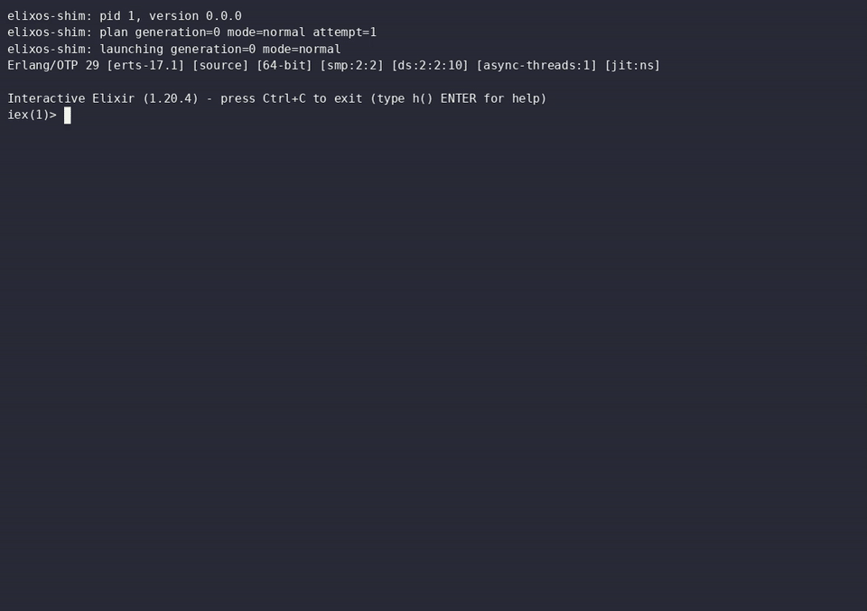

# Elixos

[Watch the recording](demos/m06-live-image.mp4) · [All demos](demos/README.md)

**The Elixir operating system.** An unmodified mainline Linux kernel boots a
tiny Zig PID 1 shim, which runs the BEAM and drops you at `iex(1)>`. IEx is the
default shell; a POSIX shell exists for tooling. Programs are packages,
commands are functions, and the running system is a live image you can save.

For shipping living Elixir apps as well as personal machines: USB sticks,
cyberdecks and SBCs. The image build is moving to pinned Alpine packages,
targeting **x86_64 and aarch64**.

## Status

**M1–M15 are landed:** live generations and recovery, on-box Mix builds, SSH,
UEFI boot, trusted Hex packages and Jido agents.

**Next:** finish M16's package-built images and aarch64 smoke checks.
The coding-agent toolset and safe self-modification remain planned work.
See the [roadmap and acceptance criteria](docs/ROADMAP.md).

## Prior art and friends

- [Autolith](https://github.com/lambda-symbolics/autolith): image generations,
  rollback and recovery images, and the introspective self-modifying agent
  direction. That agent work is still ahead of us.
- [Nerves](https://nerves-project.org/) and its
  [erlinit](https://github.com/nerves-project/erlinit): a minimal PID 1 handling
  boot, mounts and shutdown while the BEAM owns application supervision.
- [AtomVM](https://github.com/atomvm/AtomVM): a lightweight VM bringing Erlang
  and Elixir to microcontrollers and other constrained devices.
- **Smalltalk and Lisp machine images:** a live world and a changes log.
  Elixos rebuilds from code and data rather than saving the BEAM heap
  ([ADR-005](docs/DECISIONS.md)).

## Build and test

`make check-tools` reports prerequisites, `make test` runs unit tests, and
`make ci` boots the QEMU acceptance images. See [TESTING](docs/TESTING.md)
for the test layers and [AGENTS.md](AGENTS.md) for the development loop.

## Docs

- [VISION](docs/VISION.md): what Elixos is and is not
- [ARCHITECTURE](docs/ARCHITECTURE.md): boot chain, shim, live image, REPLs, apps, toolchain
- [PROTOCOL](docs/PROTOCOL.md): every interface that is API (tests match it byte for byte)
- [DECISIONS](docs/DECISIONS.md): ADRs and open questions
- [ROADMAP](docs/ROADMAP.md): milestones and their acceptance tests
- [TESTING](docs/TESTING.md): how the test layers, gating and QEMU harness work
